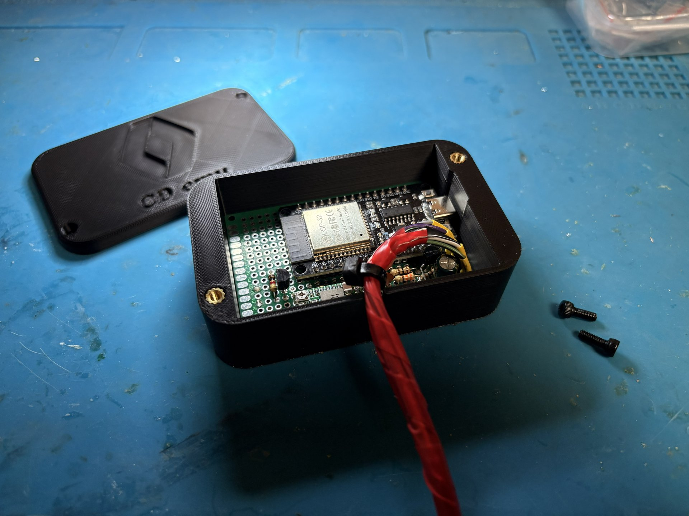
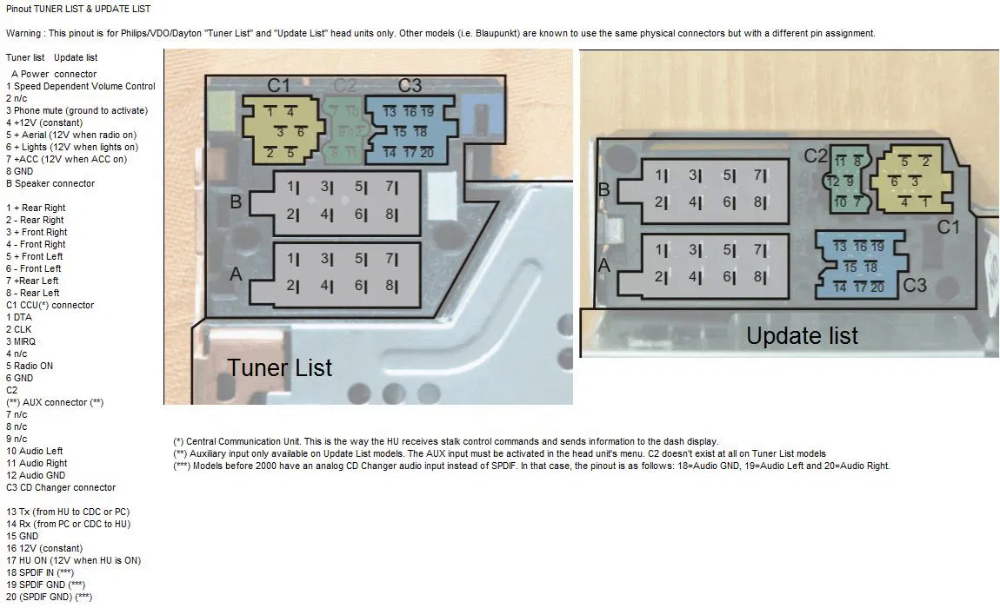
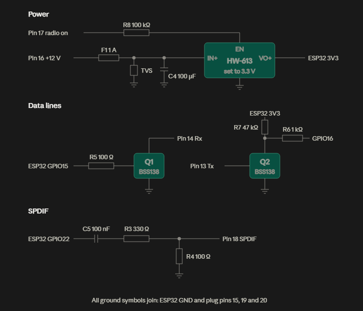
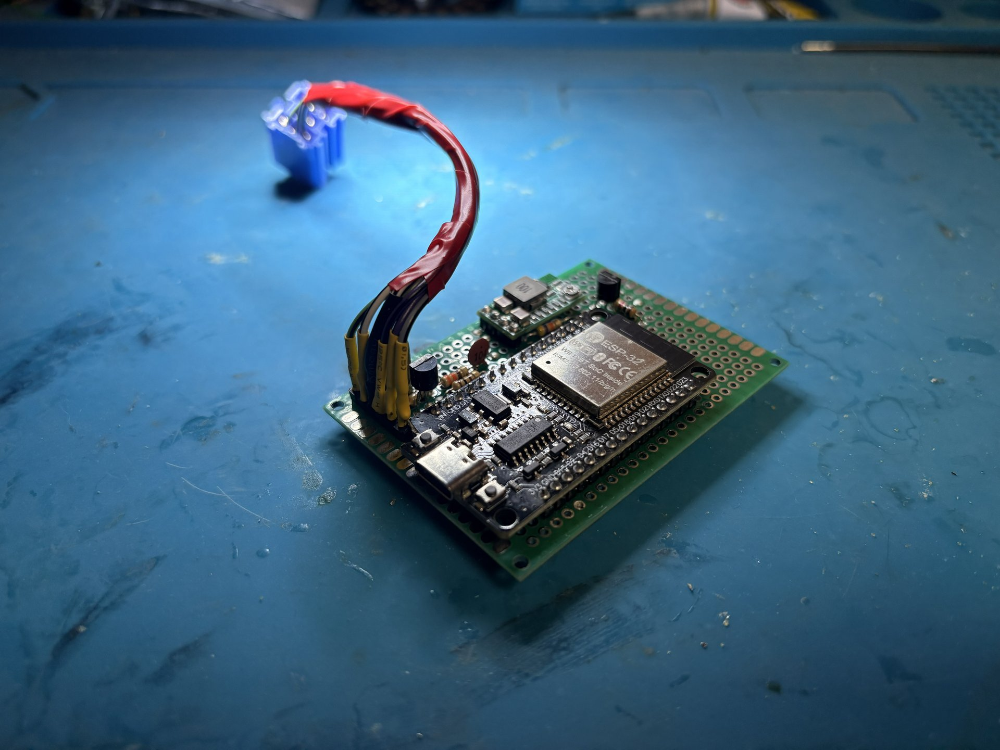
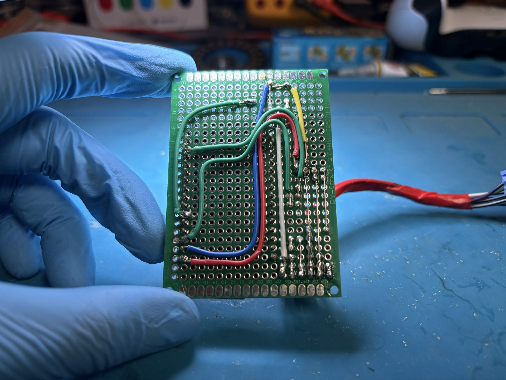

# TLCDCEmu – Bluetooth for a Renault Tuner List radio

An ESP32 that pretends to be a CD changer for the factory **Renault Tuner List** head unit.

> Built and tested on a **2004 Renault Megane II** with its factory **Tuner List** radio.
> Other Renault/Dacia Tuner List units use the same changer protocol and connector, so
> they'll likely work too, but they haven't been tested.

The radio sees a changer in its sources; the audio actually comes from a phone over
Bluetooth and goes into the radio digitally as S/PDIF. The radio's own buttons and the
steering-wheel remote control play / pause / next / previous on the phone.

This is mostly other people's work, with a few fixes needed to get it running on this car
and an iPhone – see [Credits](#credits) and [Changes to the original libraries](#changes-to-the-original-libraries).

## Folder contents

| Path | What it is |
|---|---|
| `TLCDCEmu.ino` | The ESP32 sketch (sets the Bluetooth name, starts the emulator) |
| `libraries/` | The two **modified** libraries the sketch needs |
| `RadioSim/RadioSim.ino` | Arduino Nano/Uno sketch that pretends to be the radio, for bench testing |
| `imgs/` | Pinout, wiring diagram and photos of the build |

## Hardware

- ESP32 dev board (classic ESP32 / WROOM – the S3 and C3 have no Bluetooth audio)
- HW-613 step-down converter, set to ~3.2–3.3 V with its pot (locked with glue)
- 2 × 2N7000 MOSFETs as level shifters for the radio's data lines
- Resistors, capacitors, a 1 A fuse and a TVS diode (see the diagram below)
- Blue mini-ISO plug for the radio's CD-changer socket (C3)

> **HW-613 warning:** on the board used here the **IN and EN labels were swapped** on the
> silkscreen. If the ESP32 stays powered with the radio off (or never turns on), swap those
> two wires. Also don't use its fixed-voltage solder pads – set to 3.3 V they gave ~6 V.

### Radio connector

*Pinout from the [tlcdcemu project](https://tlcdcemu.sourceforge.net/hardware.html).*

The CD changer uses connector **C3** (blue):

| Pin | Signal | Connects to |
|---|---|---|
| 13 | Tx – data from the radio | Q2 gate |
| 14 | Rx – data to the radio | Q1 drain |
| 15 | Ground | board ground |
| 16 | +12 V permanent | fuse → converter IN |
| 17 | +12 V when the radio is on | R8 (100 kΩ) → converter EN, so the ESP32 switches with the radio |
| 18 | S/PDIF in | S/PDIF network from the ESP32 |
| 19, 20 | S/PDIF ground | board ground |

### Wiring

Differences between the diagram and this build:

- **Q1 and Q2 are 2N7000s**, not the BSS138s drawn. Same circuit, same resistor values.
- **S/PDIF comes from GPIO23**, not GPIO22 as drawn.

2N7000 legs, flat face toward you, legs down: **source, gate, drain** (left to right).

**Q1 – sending data to the radio**

| Q1 leg | Connects to |
|---|---|
| Source (left) | Ground |
| Gate (middle) | One end of R5 (100 Ω); R5's other end goes to GPIO15 |
| Drain (right) | Changer pin 14 (radio Rx) |
| Optional | 100 kΩ from gate to source (keeps Q1 off while the ESP32 boots) |

**Q2 – receiving data from the radio**

| Q2 leg | Connects to |
|---|---|
| Source (left) | Ground |
| Gate (middle) | Changer pin 13 (radio Tx) |
| Drain (right) | A junction of two resistors: R7 (47 kΩ) up to the ESP32's 3V3 pin, and R6 (1 kΩ) to GPIO16 |

Both stages invert the signal. Serial format: 9600 baud, 8 data bits, even parity,
1 stop bit; on the connector side the lines idle **low**.

### ESP32 pins

| GPIO | Use |
|---|---|
| 15 | UART Tx → R5 → Q1 |
| 16 | UART Rx ← R6 ← Q2 |
| 23 | S/PDIF out |
| 13, 14 | Assigned as unused RTS/CTS by the code – leave unconnected |

### The finished board

| Top | Bottom |
|---|---|
|  |  |

## Building

1. Arduino IDE with the **esp32 board package 1.0.6** (newer 2.x/3.x cores need more
   changes to this code).
2. Copy both folders from `libraries/` into `Documents\Arduino\libraries\`.
   Use these copies, not fresh downloads – the originals lack the fixes listed below.
3. Board: **ESP32 Dev Module**. Open `TLCDCEmu.ino`, change `btName` if you like, upload.
4. After flashing for the first time, *Forget This Device* on the phone and pair again.

## Using it

Turn the radio on, wait a few seconds, press **SOURCE** until the CD changer appears.
Pair your phone with the Bluetooth name set in `TLCDCEmu.ino`.

## Bench testing without the car

`RadioSim/RadioSim.ino` on an Arduino Nano plays the radio's part of the handshake:

| Nano | Emulator connector |
|---|---|
| D2 | pin 14 |
| D3 | pin 13 |
| GND | pin 15 / ESP32 GND |

Power the ESP32 from USB, open the Nano's Serial Monitor at 115200 baud. A working setup
ends with `Handshake complete` and then a status frame every second. Commands:
`e` enter CDC, `p` play, `z` pause, `n` next, `b` previous, `s` standby, `h` help.
If the Nano is reset, reset the ESP32 too – the emulator only handshakes once after boot.

## Debugging tips

- ESP32 Serial Monitor at 115200 shows the `[CDC]` and `[BT]` lines. Opening it resets the ESP32.
- Never put a logic analyser directly on pins 13/14 in the car – they swing up to ~12 V.
  Probe GPIO15/16 instead.
- A logic analyser can't see S/PDIF on pin 18 (it's only ~0.5 V after the network);
  probe GPIO23.
- Cheap analysers label channels CH1–CH8, while Logic 2 numbers them 0–7.

## Credits

| Project | Author | What it provides | License |
|---|---|---|---|
| [ESP32TLCDCEmu](https://github.com/JohnyMielony/ESP32TLCDCEmu) | Johny Mielony | The emulator library (`ESP32_Tuner_List_CDC_Emulator`) and the original schematic | GPL-3.0 |
| [MeganeBT](https://github.com/Tomasz-Mankowski/MeganeBT) | Tomasz Mankowski | The changer protocol handling ESP32TLCDCEmu is based on | MIT |
| [ESP32-A2DP](https://github.com/pschatzmann/ESP32-A2DP) | Phil Schatzmann | Bluetooth A2DP receiver library | Apache-2.0 |
| [ESP32-A2DP fork](https://github.com/JohnyMielony/ESP32-A2DP) | Johny Mielony | S/PDIF output (`SPDIFOut`) added to ESP32-A2DP – the version in `libraries/` | Apache-2.0 |
| [tlcdcemu](https://tlcdcemu.sourceforge.net/) | tlcdcemu project | Tuner List changer protocol documentation and the connector pinout image | – |

Many thanks to all of them – this project would not exist without their work.

## Changes to the original libraries

The libraries in `libraries/` started from these versions:

| Library | Source | Commit |
|---|---|---|
| ESP32_Tuner_List_CDC_Emulator 0.1 | [JohnyMielony/ESP32TLCDCEmu](https://github.com/JohnyMielony/ESP32TLCDCEmu) | [`67ef917`](https://github.com/JohnyMielony/ESP32TLCDCEmu/commit/67ef917d48517d588aef229c03482213e1ab4d70) (2022-08-31) |
| ESP32-A2DP 1.0 | [JohnyMielony/ESP32-A2DP](https://github.com/JohnyMielony/ESP32-A2DP) | [`53d4fad`](https://github.com/JohnyMielony/ESP32-A2DP/commit/53d4fad56a46295209059464b5d19f5e7d7cfd56) (2020-12-09) |

Only one file in each library was changed, and each carries a `MODIFIED` note at the top.

### ESP32_Tuner_List_CDC_Emulator – `src/TLCDCEmu.cpp`

| Change | Why |
|---|---|
| S/PDIF output moved to **GPIO23** (`new SPDIFOut(23)`, default was 22) | Matches this build's wiring |
| **4 s start-up delay** (`CDC_STARTUP_DELAY_MS`): wait after boot, discard received bytes, then start the handshake | The ESP32 boots much faster than the radio. Without it the changer only appeared after pressing EN on the ESP32 |
| `timer_config.auto_reload` now set with `TIMER_AUTORELOAD_EN/_DIS` instead of a `bool` | Compile error: `cannot convert 'bool' to 'timer_autoreload_t'` |
| Always-on `[CDC]` log lines (handshake done, commands received from the radio) | Debugging |

### ESP32-A2DP – `src/BluetoothA2DPSink.cpp`

| Change | Why |
|---|---|
| `sendCommand()` sends a button **press and release**, each with its own transaction label | The original sent only "press", which phones ignored – radio/steering-wheel controls did nothing |
| Media control (AVRCP) initialised **before** the audio link (A2DP) and before reconnecting to the last phone | The iPhone otherwise connected for audio only and ignored all controls |
| Always-on `[BT]` log lines (link states, commands sent, phone replies) | Debugging |

## Status

Working in the car: the changer shows up after switch-on, audio plays over S/PDIF, and the
radio and steering-wheel controls work with an iPhone.

## Known issues

- **Short burst of static when skipping tracks.** Likely cause: while the phone switches
  songs, no audio arrives and the ESP32's I2S driver replays its last buffers. Proposed
  fix (not done yet): output encoded S/PDIF silence when no audio arrives.
- The emulator does not re-handshake if the radio restarts while the ESP32 stays powered.

## License

This project is licensed under **GPL-3.0** (see `LICENSE`), matching the emulator library
it's built on. The bundled libraries keep their own licenses: `libraries/ESP32-A2DP` is
Apache-2.0, `libraries/ESP32_Tuner_List_CDC_Emulator` is GPL-3.0.
